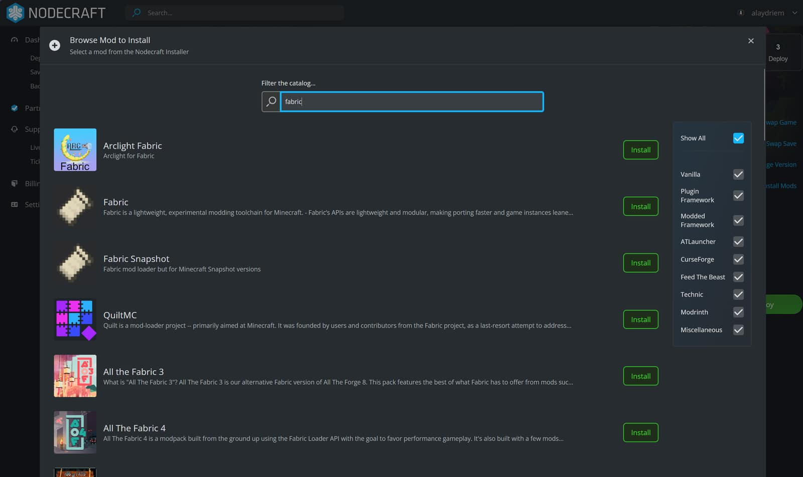
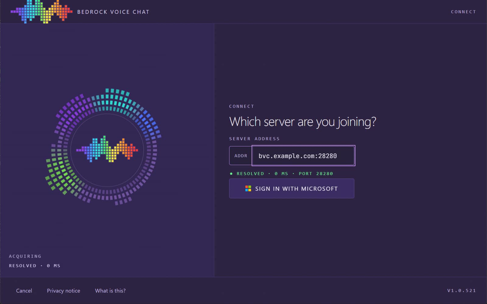

Install Bedrock Voice Chat on a Nodecraft Pro server that runs Fabric. The BVC server runs inside the Minecraft server (embedded mode). For the full list of mod settings, see [Fabric](/wiki/server/java-mod/fabric/).

## Before you start

You need:

- A Nodecraft Pro server. See [Nodecraft](/wiki/platforms/nodecraft/).
- One of these:
  - Nothing more. BVC gives the server a [play name](/wiki/server/tls/#play-name).
  - A domain name, with DNS at Cloudflare or another [supported provider](/wiki/server/tls/), and a Cloudflare API token for that zone with DNS edit permission. See [TLS certificates](/wiki/server/tls/).

:::caution
You **MUST** use a Pro server. Lite servers stop when nobody plays. Bedrock Voice Chat then stops too.
:::

## Install Fabric

1. Create a new **Pro** game server.
2. During server setup, add a mod for **Fabric**.
3. Select **Create and Deploy**. Wait for the installation to complete.

   <div class="window"></div>

## Upload the mods

1. Download [fabric-api](https://modrinth.com/mod/fabric-api) and [Bedrock Voice Chat](https://modrinth.com/mod/bedrock-voice-chat) from Modrinth. Select the Fabric versions that match your Minecraft version. To let Bedrock players join, also download the Fabric versions of Geyser and Floodgate. To connect players who use Simple Voice Chat, also download Simple Voice Chat.
2. In **Server Files** > **File Manager**, open the `mods` directory.
3. Select **Upload**, and upload all the `.jar` files.

   <div class="shot"><span>Nodecraft File Manager, mods directory with the BVC jar</span></div>

4. In the Pro Panel, select **Overview**. Copy the **Dedicated IP**.
5. Create `config/bedrock-voice-chat.json`.

   Without a domain:

   ```json
   {
     "minimum-players": 1,
     "use-embedded-server": true,
     "embedded-config": {
       "server": {
         "port": 28280,
         "quic_port": 28280,
         "tls": {
           "play": {
             "address": "203.0.113.10"
           }
         }
       }
     }
   }
   ```

   With a domain:

   ```json
   {
     "minimum-players": 1,
     "use-embedded-server": true,
     "embedded-config": {
       "server": {
         "port": 28280,
         "quic_port": 28280,
         "tls": {
           "names": ["bvc.example.com"],
           "ips": [],
           "acme": {
             "email": "your-cloudflare-email@example.com",
             "provider": "cloudflare",
             "api_token": "cfut_api-token"
           }
         }
       }
     }
   }
   ```

6. Replace `203.0.113.10` with your Dedicated IP. With a domain, replace `bvc.example.com`, the email, and the API token with your values.

:::caution
1. Keep both ports at 28280. Do not change them.
2. Do not use your Nodecraft hostname. At this time, BVC cannot get a TLS certificate for the hostname that Nodecraft gives a Pro server.
3. With a domain, use Cloudflare or another supported DNS provider. BVC then gets and renews the TLS certificate automatically.
:::

## Point your domain at the server

Skip this section if you use a play name.

1. At your DNS provider, add an `A` record for your BVC name, for example `bvc.example.com`, with the Dedicated IP as its value.
2. In Cloudflare, set the record's proxy status to **DNS only**.

BVC gets the TLS certificate the first time it starts. This can take one minute. Wait, then sign in for the first time. If players cannot sign in after BVC gets its first certificate, restart the Java server.

:::caution
The mod stores its certificate authority (the key that signs player certificates) in `config/bedrock-voice-chat/`. Download a copy of this directory from **Server Files** and keep it. If you delete it, all client certificates that the server issued become invalid, and all players must sign in again.
:::

## Chat sync

To read and send in-game chat from the BVC app, set this line in `server.properties`:

```properties
enforce-secure-profile=false
```

Edit `server.properties` in **Server Files**, then restart the server. See [chat](/wiki/player/chat/).

## Connect

Your players sign in with `https://bvc.example.com:28280`. Use your play name or your domain. To find the play name, look in the server console for `Play name assigned`. See [signing in](/wiki/player/signing-in/).

<div class="window"></div>

## Next steps

1. Make yourself an admin from the server console:

   ```
   /bvc admin grant <Gamertag>
   ```

   Use your Xbox gamertag. Put it in quotes if it contains a space. See [Java commands](/wiki/player/in-game-commands/java/#admin).

2. Send your players to [Downloads](/wiki/start/downloads/). They can then sign in.